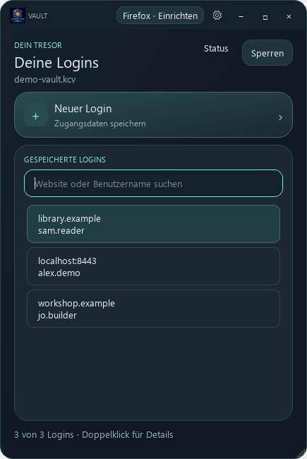
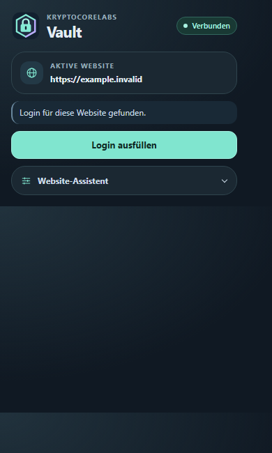
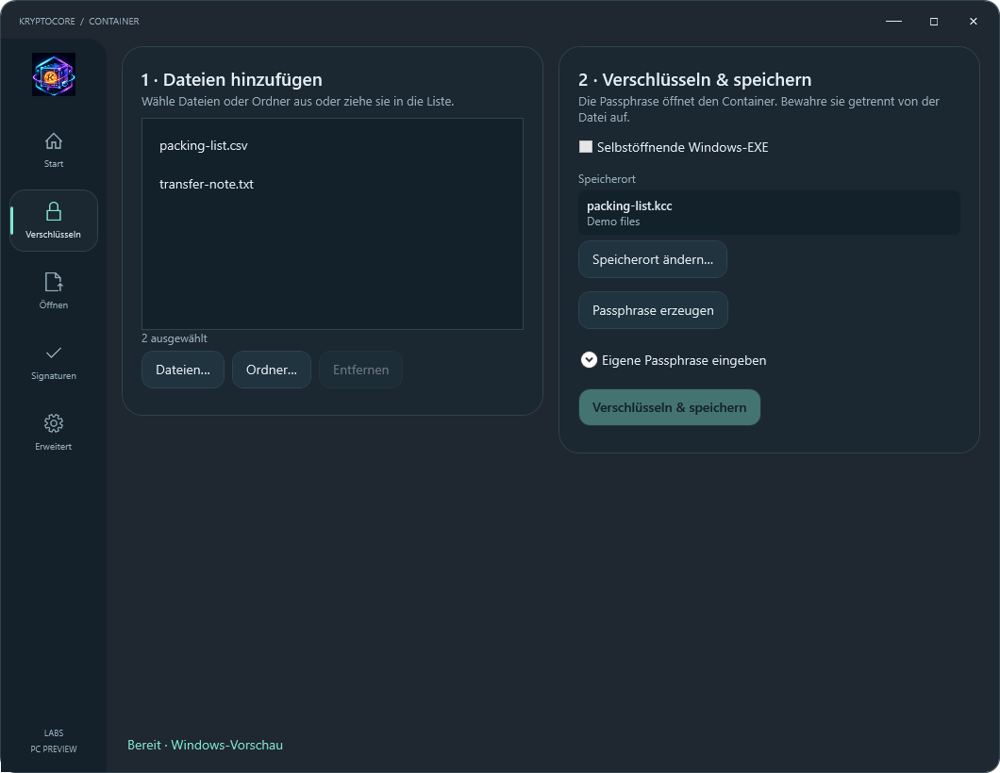
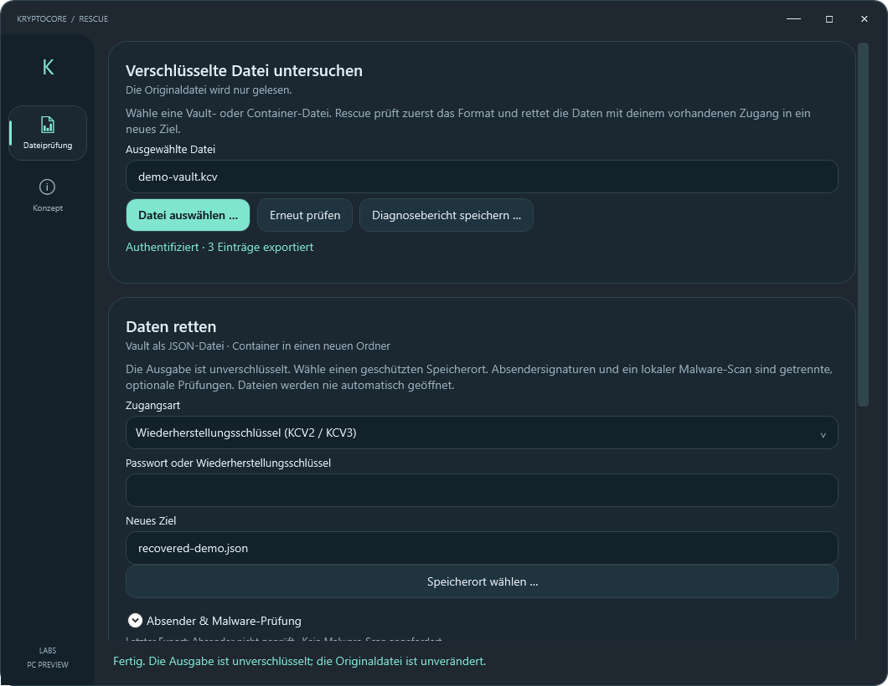
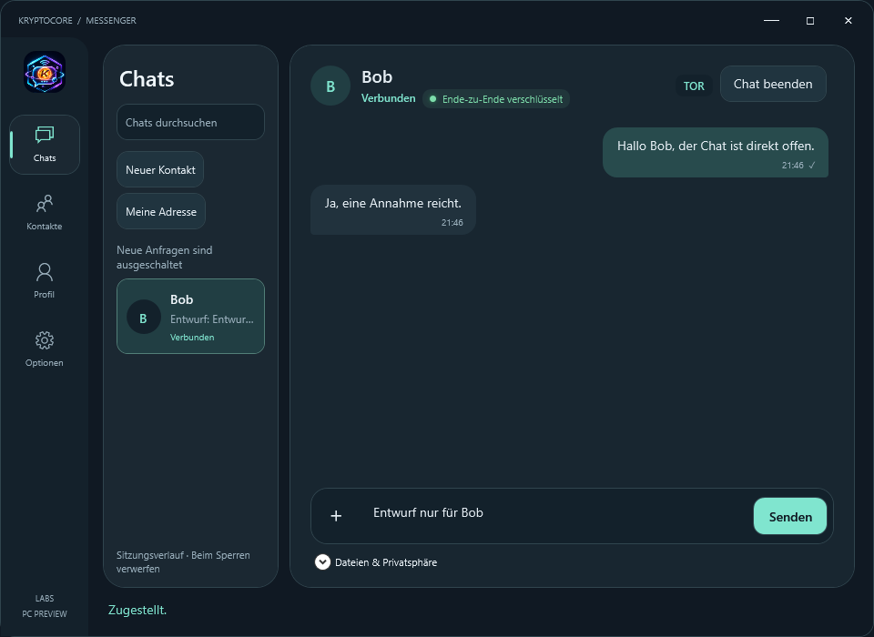

# Try KryptoCore with sample data

Open a vault with three invented logins, unpack two sample files, recover the
vault independently, or see what an encrypted conversation looks like.
The inputs, passwords, recovery key and signing test vector are public.
Use a fresh demo folder and a separate Firefox profile for this walkthrough.

[Download the demo folder in the profile ZIP](https://github.com/kryptocorelabs/kryptocorelabs/archive/refs/heads/main.zip) · [App downloads and source](../README.md#projects)

## Vault



1. Copy [demo-vault.kcv](fixtures/demo-vault.kcv) to a writable folder and open
   the copy in Vault.
2. Enter `Northstar demo vault only`. Search for `library` and open the
   `sam.reader` entry to inspect it.
3. To try migration, use [the JSON input](inputs/logins.json) with Vault's
   JSON import feature and choose a fresh destination. The three login
   records are also readable directly in that JSON file.

## Firefox



The image shows the popup layout. To try real autofill on Windows, unlock the
demo vault and install and pair the signed 0.1.16 add-on using the
[Firefox guide](https://github.com/kryptocorelabs/vault/blob/main/FIREFOX.md).
The vault includes a login for `https://localhost:8443`.

With Python and OpenSSL available, run this from the demo directory:

```sh
openssl req -x509 -newkey rsa:2048 -nodes -days 1 -subj "/CN=localhost" -addext "subjectAltName=DNS:localhost" -keyout demo-tls.key -out demo-tls.crt
python serve-login.py demo-tls.crt demo-tls.key
```

Open `https://localhost:8443/` in the separate Firefox profile. Accept the
local certificate exception for this address in that profile. Select
**Login ausfüllen** in the add-on. The expected username is `alex.demo`.
The page stays on the loopback interface and handles the mock submit in the
page. Stop the server with Ctrl+C when finished.

## Container



Open [demo-container.kcc](fixtures/demo-container.kcc) in Container with
`Northstar demo transfer only` and extract to a new folder. Compare the
results with [packing-list.csv](inputs/files/packing-list.csv) and
[transfer-note.txt](inputs/files/transfer-note.txt). You can also select those
two files in **Verschlüsseln** and create a fresh container.

## Rescue



Select the same [demo-vault.kcv](fixtures/demo-vault.kcv) in Rescue and choose
**Wiederherstellungsschlüssel**. Use the public demo key below and a new JSON
destination. Confirm the plaintext export and compare the three recovered
records with [the inputs](inputs/logins.json).

```text
0123456789abcdef0123456789abcdef0123456789abcdef0123456789abcdef
```

Repeat with the vault password and a different destination if you want to
compare both routes. Rescue reads the original file and writes a separate
unencrypted export.

## Messenger



Alice and Bob are disposable identities from the Windows loopback test.
The screenshot comes from a running chat. The harness also exercises a
synthetic attachment transfer. It routes the two test peers over loopback
with Tor networking disabled. Re-run it with `--loopback` using the
[Messenger test instructions](https://github.com/kryptocorelabs/apps-source/tree/main/apps/msg/tests).
The identities and contact state are generated for each run.

## Verify

From this directory, use a trusted build of `kryptocore-verify` on your PATH.
The demo verification key belongs to a public test vector, and the manifest
names a fictional release.

```sh
kryptocore-verify check inputs/files/transfer-note.txt fixtures/verify/release.json fixtures/verify/release.sig --key KCP1:d75a980182b10ab7d54bfed3c964073a0ee172f3daa62325af021a68f707511a --product northstar-demo --version 1.0-demo --target demo
```

Expect `VERIFIED`. Copy the note to another directory under the same filename,
change one byte and point Verify at that copy. Expect `NOT VERIFIED`.
The manifest expires as part of the normal validity check. Regenerate the
fixtures below when it expires.

## Core and signatures

The Core is a library. Try the
[Rust round trip](https://github.com/kryptocorelabs/kryptocore#quick-start)
with a short synthetic message. The Verify example above exercises the
[shared Ed25519 signature module](https://github.com/kryptocorelabs/kryptocore/tree/main/modules/signatures)
with its release-manifest purpose.

## Rebuild the fixtures

Use Python 3.9+ and OpenSSL 3.x. Build the native workers with the locked
dependencies from [vault-source](https://github.com/kryptocorelabs/vault-source)
and [apps-source](https://github.com/kryptocorelabs/apps-source).

```sh
# In vault-source
cargo build --locked --release -p kryptocore-vault

# In apps-source
cargo build --locked --release -p kryptocore-desktop-engine -p kryptocore-rescue -p kryptocore-verify
```

Pass the worker paths from each checkout's `target/release` directory to
[the fixture generator](generate-fixtures.py). On Windows use the `.exe` paths.

```sh
python generate-fixtures.py regenerated --vault PATH_TO_KRYPTOCORE_VAULT --container PATH_TO_KRYPTOCORE_DESKTOP_ENGINE --rescue PATH_TO_KRYPTOCORE_RESCUE --verify PATH_TO_KRYPTOCORE_VERIFY
```

Choose a new output directory. The script uses the actual native workers and
checks both Rescue routes, a wrong credential, unpacked bytes, and accepted
and modified Verify inputs. Fresh salts, keys and manifest timestamps change
the generated bytes. Use the regenerated files together with these same
plaintext inputs.

The apps are previews tested by the maintainers and CI. Community testing is
welcome. Share workflow or documentation feedback in
[Discussions](https://github.com/kryptocorelabs/kryptocore/discussions).
Report suspected vulnerabilities through
[the private reporting process](https://github.com/kryptocorelabs/kryptocore/blob/main/SECURITY.md).
